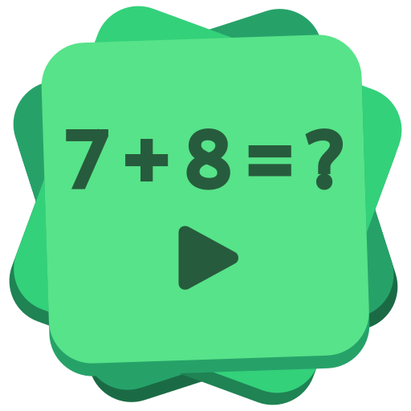

# Numo

**Mental math training**

## About project 🧠
Numo is GNOME app for mental arithmetic practice. Tasks appear one after another, answers are checked on the spot, and nothing gets in the way — just you and the numbers. Pick one of four game modes, choose a preset difficulty, or build your own with Custom: pick the operations and set the ranges.

### Game modes
- **Survival**: an endless run of tasks that ends the moment you make a mistake. A test of focus and consistency.
- **Timer**: a fixed countdown. Solve as many tasks as you can before time runs out.
- **Timer + Bonus**: start with a small amount of time and earn extra seconds for every correct answer.
- **Task Count**: a set number of tasks to solve. A clear goal to reach at your own pace. 

### Difficulty levels
- **Easy**: addition, subtraction, and a bit of multiplication. Simple operations using small numbers, with no negative numbers.
- **Medium**: precise division is introduced. Numbers become larger, problems more complex, and addition and subtraction operations may involve negative values.
- **Hard**: integer division and mod are introduced, and negative numbers may now appear in multiplication and division operations.
- **Custom**: Complete control over the task. Choose any combination of operations, set custom number ranges for each, and specify whether subtraction results are allowed to be negative. There are, however, a few constraints: at least one operation must remain enabled, and each range must span a minimum of five values.

### Statistics
Every session is recorded: result, accuracy, and time spent. The statistics screen shows your best results per mode and difficulty, recent games. The number of recent sessions shown is adjustable in settings. Data can be exported and imported as JSON at any time.
  
## My first project 🌟
This is my first GNOME application built with GTK4 and libadwaita. I'm using it as an opportunity to learn modern GNOME development practices.

If you spot something that could be done better according to the GNOME way, I'd be glad to hear about it.
  
## Roadmap 🗺️
  
The list below is not a rigid schedule, but merely an outline of the directions in which I would like to move.
  
### Modes
  - **New game modes**: no concrete ideas yet. Candidate: "Reverse" (given the result, find the expression). Open to suggestions.
  
### Localization
  - **Prepare the project for translations** 

## License

Numo is distributed under the terms of the GNU General Public License,
version 3 or later. See [COPYING](COPYING) for details.

